# Cat and Dog Recognition Using Convolutional Networks

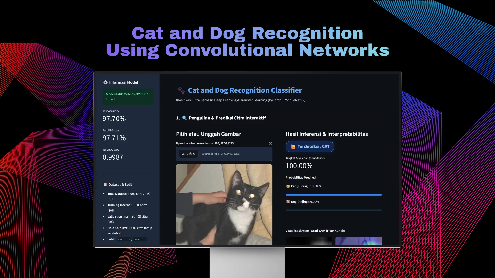


## Project Overview

**Cat and Dog Recognition Using Convolutional Networks** is an end-to-end Deep Learning image classification project built with PyTorch and Torchvision to distinguish between cat (`0`) and dog (`1`) RGB photographs. The repository implements an automated dataset integrity and deduplication audit, a leakage-free stratified splitting protocol, a comparative training pipeline between a custom 4-block Convolutional Neural Network (CNN) baseline and two-stage MobileNetV2 transfer learning, quantitative hold-out evaluation, Grad-CAM visual explainability, and an interactive Streamlit web dashboard for real-time inference.

## Problem Statement & Objectives

Visual classification between cats and dogs presents substantial intra-class variance across breeds, fur patterns, body sizes, camera angles, lighting conditions, and cluttered domestic or outdoor backgrounds. Training convolutional architectures from scratch on modest dataset sizes often struggles to learn robust low-level and semantic representations without overfitting or underfitting.

- Audit all raw JPEG image files for readability, color mode consistency, resolution spread, and exact MD5 duplicate collisions prior to modeling.
- Enforce a strict data-leakage prevention protocol by isolating the archive `validation/` directory as a one-time hold-out test set (`1,000` images) and applying an `80:20` stratified split on `train/` (`1,600` internal training / `400` internal validation images).
- Benchmark a scratch-trained 4-block `CustomBaselineCNN` against ImageNet-pretrained `MobileNetV2` under both frozen feature extraction and selective top-layer fine-tuning (layers 14–18).
- Select the optimal model objectively from internal validation F1-Score and accuracy, then verify generalization once on the unseen hold-out test set using Accuracy, Precision, Recall, F1-Score, ROC-AUC, PR-AUC, and Confusion Matrix analysis.
- Validate spatial decision-making with Gradient-weighted Class Activation Mapping (Grad-CAM) and expose model inference through both a CLI tool and a dark-mode Streamlit web application.

## Data & Input Sources

The project operates on a balanced binary image dataset of `3,000` RGB JPEG images (`1,500` cats and `1,500` dogs) stored under [`dataset/original/`](dataset/original) and indexed in [`dataset_split.json`](dataset_split.json) and [`dataset_audit.json`](dataset_audit.json). As verified by [`src/data_audit.py`](src/data_audit.py), all `3,000` files are valid RGB JPEGs with `0` corrupted files and `0` MD5 duplicate hash clusters.

| Attribute | Description |
|---|---|
| Dataset / Input Source | Local Cat & Dog Image Archive (`3,000` images total) |
| Source | [`dataset/original/`](dataset/original) (`train/` and `validation/` folders) |
| Format | JPEG (`3,000` files, `100%` RGB color mode) |
| Samples / Records | `1,600` Train Internal (`800` cats / `800` dogs), `400` Val Internal (`200` / `200`), `1,000` Hold-Out Test (`500` / `500`) |
| Features / Input Shape | Variable raw dimensions (`59–1,050` px wide, `41–768` px tall; mean `405.66 x 360.20` px) standardized to `3 x 224 x 224` tensors |
| Target / Label | Binary class label: `cats` (`0`) vs `dogs` (`1`) |

## Data Preprocessing & Feature Engineering

Because raw images vary widely in resolution and aspect ratio (mean aspect ratio `1.1617`), [`src/dataset.py`](src/dataset.py) applies distinct stochastic training augmentations and deterministic evaluation transforms while normalizing all tensors with ImageNet channel statistics (`mean = [0.485, 0.456, 0.406]`, `std = [0.229, 0.224, 0.225]`).

| Stage | Input | Transformation / Configuration | Output |
|---|---|---|---|
| Integrity & Hash Audit | Raw JPEG files | `PIL.Image.verify()`, RGB mode check, MD5 digest deduplication | Clean manifest ([`dataset_audit.json`](dataset_audit.json)) |
| Leakage-Free Splitting | `train/` (`2,000`) & `validation/` (`1,000`) | Stratified `80:20` split on `train/` (`seed = 42`); `validation/` locked as hold-out test | [`dataset_split.json`](dataset_split.json) |
| Training Augmentation | Internal train RGB images | `RandomResizedCrop(224, scale=(0.8, 1.0), ratio=(0.85, 1.15))`, `RandomHorizontalFlip(0.5)`, `RandomRotation(15)`, `ColorJitter(0.15, 0.15, 0.1)` | Augmented `3 x 224 x 224` float tensors |
| Deterministic Eval | Internal val & hold-out test images | `Resize(256)` followed by `CenterCrop(224)` and ImageNet normalization | Clean `3 x 224 x 224` float tensors |

1. Scan every image across `train/` and `validation/` to verify decode integrity, image dimensions, and MD5 uniqueness.
2. Partition `train/` into `1,600` training and `400` validation samples via stratified sampling (`RANDOM_SEED = 42`), leaving `validation/` completely isolated for final testing.
3. Apply geometric and photometric data augmentations exclusively to the `train_internal` DataLoader (`batch_size = 32`).
4. Normalize all splits into `3 x 224 x 224` PyTorch tensors prior to forward passes.

## Tech Stack

| Category | Technology | Purpose |
|---|---|---|
| Programming Language | Python | Core pipeline scripting, data processing, and application logic |
| Deep Learning Framework | PyTorch | Neural network construction, autograd optimization, and checkpointing |
| Computer Vision | Torchvision | Pretrained MobileNetV2 weights (`IMAGENET1K_V1` / `DEFAULT`) and image transforms |
| Numerical & Tabular Data | NumPy, Pandas | Array computations, split manifests, and prediction log tables |
| Image Processing | Pillow (PIL) | Image decoding, integrity verification, RGB conversion, and heatmap resizing |
| Metrics & Evaluation | Scikit-Learn | Accuracy, Precision, Recall, F1-Score, ROC-AUC, PR-AUC, Confusion Matrix |
| Data Visualization | Matplotlib, Seaborn | Training curves, EDA charts, ROC/PR curves, confusion matrices, Grad-CAM plots |
| Web Application | Streamlit | Interactive browser dashboard for single-image prediction and model analytics |

## Machine Learning Approach

The project formulates cat-versus-dog recognition as a binary supervised Deep Learning image classification task outputting a single raw logit trained with `BCEWithLogitsLoss`. It systematically compares learning representations from scratch against two-phase transfer learning on a lightweight mobile-optimized convolutional backbone.

| Attribute | Value |
|---|---|
| Learning Paradigm | Deep Learning |
| Problem Domain | Computer Vision |
| ML Task | Binary Image Classification |
| Input | RGB Image Tensor (`3 x 224 x 224`) |
| Target / Output | Binary logit transformed via Sigmoid into `P(Dog)` (`0` = Cat, `1` = Dog, threshold `0.5`) |
| Primary Approach | Two-stage Transfer Learning (`MobileNetV2` frozen feature extraction + top-layer fine-tuning) benchmarked against `CustomBaselineCNN` |

## Model Overview

Three model configurations are defined in [`src/models.py`](src/models.py) and evaluated in [`src/train.py`](src/train.py): a custom 4-block CNN trained from scratch and two progressive transfer learning stages based on `MobileNetV2`.

| Model Name | Architecture / Layers | Pretrained Status | Trainable Scope & Classifier Head |
|---|---|---|---|
| `CustomBaselineCNN` | 4 blocks of `Conv2d(3x3, pad=1)` + `BatchNorm2d` + `ReLU` + `MaxPool2d(2,2)` (`3->32->64->128->128`) + `AdaptiveAvgPool2d(1,1)` | Trained from scratch | Full network; `Dropout(0.4) -> Linear(128, 64) -> ReLU -> Dropout(0.2) -> Linear(64, 1)` |
| `MobileNetV2_FeatureExtractor` | ImageNet-pretrained `MobileNetV2` inverted residual backbone | Pretrained (`DEFAULT`) | All `features` frozen; new head `Dropout(0.3) -> Linear(1280, 1)` trained |
| `MobileNetV2_FineTuned` | `MobileNetV2` initialized from best Stage 1 checkpoint | Pretrained + Fine-Tuned | `features[14:19]` (top 5 blocks) and `classifier` unfrozen with differential learning rates |

## ML Workflow

The implemented pipeline spans seven sequential stages documented across [`final_report.md`](final_report.md) and the modular scripts in [`src/`](src) and [`streamlit/`](streamlit):

1. **Dataset Audit & Stratified Splitting** ([`src/data_audit.py`](src/data_audit.py)): Verifies all `3,000` JPEG RGB images, checks for `0` MD5 duplicates, records resolution statistics in [`dataset_audit.json`](dataset_audit.json), generates exploratory charts, and writes the stratified split manifest to [`dataset_split.json`](dataset_split.json).
2. **Dataset Loading & Augmentation** ([`src/dataset.py`](src/dataset.py)): Builds `CatDogDataset` and PyTorch `DataLoader` pipelines (`batch_size = 32`) with random spatial/color augmentations for training and deterministic `Resize(256)` + `CenterCrop(224)` transforms for validation and testing.
3. **Architecture Construction** ([`src/models.py`](src/models.py)): Instantiates `CustomBaselineCNN` and `build_mobilenet_v2`, plus `unfreeze_mobilenet_top_layers(start_layer_index=14)` for Stage 2 fine-tuning.
4. **Multi-Stage Model Training** ([`src/train.py`](src/train.py)): Trains all three models sequentially on `train_internal`, monitors `val_internal` loss with `ReduceLROnPlateau` and early stopping, persists checkpoints in [`models/`](models), and logs [`training_histories.json`](training_histories.json) and [`models/model_config.json`](models/model_config.json).
5. **Comparative Validation & Hold-Out Evaluation** ([`src/evaluate.py`](src/evaluate.py)): Benchmarks all three checkpoints on `val_internal` (`400` images), selects `MobileNetV2 Fine-Tuned`, executes one-time evaluation on `holdout_test` (`1,000` images), and exports [`metrics.json`](metrics.json), [`classification_report.txt`](classification_report.txt), [`dataset/predictions.csv`](dataset/predictions.csv), and figures in [`figures/`](figures).
6. **Grad-CAM Explainability Generation** ([`src/predict.py`](src/predict.py) & [`src/evaluate.py`](src/evaluate.py)): Hooks forward activations and backward gradients at `model.features[-1]` to produce spatial heatmaps and overlays confirming anatomical focus.
7. **CLI & Streamlit Serving** ([`src/predict.py`](src/predict.py) & [`streamlit/app.py`](streamlit/app.py)): Loads [`models/best_model.pt`](models/best_model.pt) for single-image CLI prediction or interactive browser-based uploads with live Grad-CAM overlays and evaluation metrics.

## ML Pipeline Architecture

The diagram below illustrates the implemented data-leakage-proof pipeline from raw image auditing and stratified partitioning through multi-stage CNN training, internal validation selection, one-time hold-out testing, and interactive Grad-CAM inference.

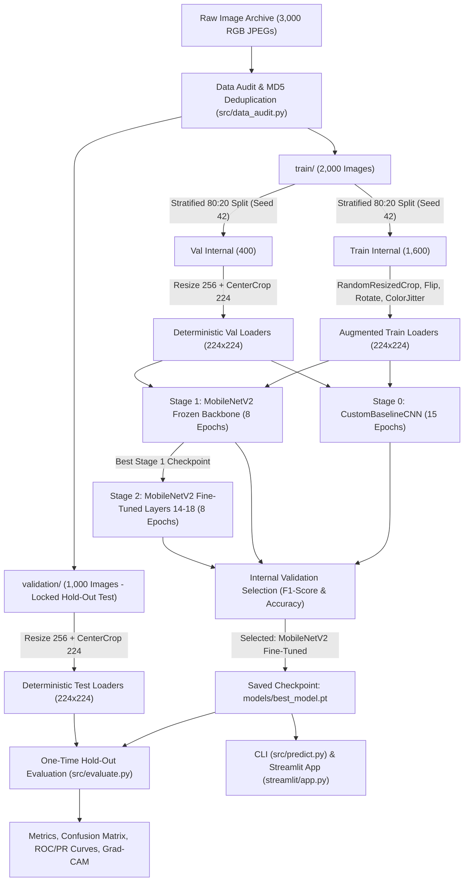

## Model Training & Configuration

All training experiments in [`src/train.py`](src/train.py) ran deterministically with `RANDOM_SEED = 42` on CPU (`PyTorch 2.15.0+cpu`, `batch_size = 32`) using `BCEWithLogitsLoss`, the `Adam` optimizer (`weight_decay = 1e-4`), `ReduceLROnPlateau(mode='min', factor=0.5)`, and checkpoint saving keyed on minimum validation loss.

| Parameter | `CustomBaselineCNN` | `MobileNetV2_FeatureExtractor` | `MobileNetV2_FineTuned` |
|---|---|---|---|
| Initialization | Random (PyTorch default) | Pretrained ImageNet-1K | Best `mobilenetv2_feature_extractor.pt` |
| Input Resolution | `224 x 224` RGB | `224 x 224` RGB | `224 x 224` RGB |
| Batch Size | `32` | `32` | `32` |
| Optimizer & Weight Decay | `Adam` (`weight_decay=1e-4`) | `Adam` (`weight_decay=1e-4`) | `Adam` (`weight_decay=1e-4`) |
| Learning Rate | `1e-3` | `1e-3` (classifier only) | `1e-4` (backbone `14+`), `5e-4` (head) |
| LR Scheduler | `ReduceLROnPlateau(factor=0.5, patience=3)` | `ReduceLROnPlateau(factor=0.5, patience=2)` | `ReduceLROnPlateau(factor=0.5, patience=2)` |
| Loss Function | `BCEWithLogitsLoss` | `BCEWithLogitsLoss` | `BCEWithLogitsLoss` |
| Epochs / Early Stopping Patience | `15` epochs (patience `5`) | `8` epochs (patience `4`) | `8` epochs (patience `4`) |
| Recorded Training Duration | `1,099.65 s` (~18.3 min) | `487.78 s` (~8.1 min) | `542.96 s` (~9.0 min) |
| Best Validation Loss / Accuracy | `0.5749` / `70.50%` (Epoch 14) | `0.1481` / `95.75%` (Epoch 8) | `0.0530` / `98.25%` (Epoch 6) |

```bash
python src/train.py
```

## Model Comparison & Selection

Model selection was strictly governed by performance on the `400`-image `val_internal` split recorded in [`metrics.json`](metrics.json) to keep the hold-out test set untouched until final evaluation.

| Model | Training Strategy | Val Accuracy | Val Precision | Val Recall | Val F1-Score | Val ROC-AUC | Val PR-AUC |
|---|---|---:|---:|---:|---:|---:|---:|
| Custom CNN Baseline | From scratch (`15` epochs) | `70.50%` | `72.04%` | `67.00%` | `69.43%` | `0.7682` | `0.7781` |
| MobileNetV2 Feature Extractor | Frozen backbone (`8` epochs) | `95.75%` | `96.92%` | `94.50%` | `95.70%` | `0.9932` | `0.9939` |
| **MobileNetV2 Fine-Tuned** | Unfrozen blocks `14–18` (`8` epochs) | **`98.25%`** | **`98.49%`** | **`98.00%`** | **`98.25%`** | **`0.9980`** | **`0.9983`** |

## Model Artifacts & Checkpoints

All trained weights, model metadata, and evaluation outputs are persisted in [`models/`](models) and the repository root for reproducible inference and reporting.

| Artifact | Format | Purpose | Location |
|---|---|---|---|
| Best Selected Model Weights | PyTorch Checkpoint (`.pt`) | Copy of `MobileNetV2_FineTuned` state dict used by CLI & Streamlit | [`models/best_model.pt`](models/best_model.pt) |
| Fine-Tuned MobileNetV2 Weights | PyTorch Checkpoint (`.pt`) | Best Stage 2 checkpoint saved at lowest validation loss (`0.0530`) | [`models/mobilenetv2_finetuned.pt`](models/mobilenetv2_finetuned.pt) |
| Frozen MobileNetV2 Weights | PyTorch Checkpoint (`.pt`) | Stage 1 feature-extractor checkpoint (`95.75%` val accuracy) | [`models/mobilenetv2_feature_extractor.pt`](models/mobilenetv2_feature_extractor.pt) |
| Custom CNN Baseline Weights | PyTorch Checkpoint (`.pt`) | Scratch-trained 4-block CNN baseline checkpoint (`70.50%` val accuracy) | [`models/baseline_custom_cnn.pt`](models/baseline_custom_cnn.pt) |
| Model Inference Configuration | JSON | Stores architecture name, `224x224` input size, ImageNet normalization, class map, seed | [`models/model_config.json`](models/model_config.json) |
| Evaluation & Training Logs | JSON / TXT / CSV | Structured validation/test metrics, epoch histories, classification report, predictions | [`metrics.json`](metrics.json), [`training_histories.json`](training_histories.json), [`classification_report.txt`](classification_report.txt), [`dataset/predictions.csv`](dataset/predictions.csv) |

## Model Evaluation & Results

Evaluated once on the unseen `1,000`-image `holdout_test` set (`500` cats, `500` dogs), the selected `MobileNetV2 Fine-Tuned` model achieved strong generalization across all binary classification metrics reported in [`metrics.json`](metrics.json) and [`classification_report.txt`](classification_report.txt).

| Metric | Hold-Out Test Score (`n = 1,000`) | Class / Scope |
|---|---:|---|
| Accuracy | `97.70%` | Overall (`977 / 1,000` correct) |
| Precision (Dog = Positive) | `97.23%` | Dogs (`cats` precision: `98.18%`) |
| Recall (Dog = Positive) | `98.20%` | Dogs (`cats` recall: `97.20%`) |
| F1-Score | `97.71%` | Dogs (`cats` F1: `97.69%`, macro avg: `97.70%`) |
| ROC-AUC | `0.9987` | Full hold-out probability ranking |
| PR-AUC (Average Precision) | `0.9988` | Balanced binary class distribution (`AP = 0.50` baseline) |

- **Confusion Matrix Breakdown (`holdout_test`)**: `486` True Negatives (cats classified as cats, `97.2%`), `14` False Positives (cats misclassified as dogs, `2.8%`), `9` False Negatives (dogs misclassified as cats, `1.8%`), and `491` True Positives (dogs classified as dogs, `98.2%`).
- **Error Pattern Analysis**: Misclassifications (`23` total images) predominantly involve long-haired or occluded cats (`14` cases) and small toy-breed dogs or curled sleeping dogs (`9` cases) whose ear geometry and silhouettes resemble the opposite class.
- **Scope Limitation**: The model performs binary `Cat` vs `Dog` classification on single-subject images at `224 x 224` resolution and does not detect multiple animals per frame, identify breeds, or reject out-of-distribution species.

## Model Explainability & Interpretability

To verify that predictions rely on animal morphology rather than background artifacts, [`src/predict.py`](src/predict.py) implements a `GradCAM` class hooking forward activations and full backward gradients on the final convolutional block (`model.features[-1]`).

| Component | Implementation Detail | Observed Visual Finding |
|---|---|---|
| Target Layer Hook | `model.features[-1]` (`features[18]` in MobileNetV2) | Captures `7 x 7` high-level semantic spatial feature maps |
| Cat Attention Focus | Positive activation maps for class `0` (`-logit`) | Concentrates on eyes, whiskers, and triangular upright ears |
| Dog Attention Focus | Positive activation maps for class `1` (`+logit`) | Concentrates on muzzle, nose, tongue, and jaw structure |
| Background Suppression | Bilinear upsampling & jet colormap overlay | Near-zero activation on carpets, grass, cages, and human hands |

## Results Visualization & Preview

### 1. Interactive Prediction Dashboard & Confidence Breakdown
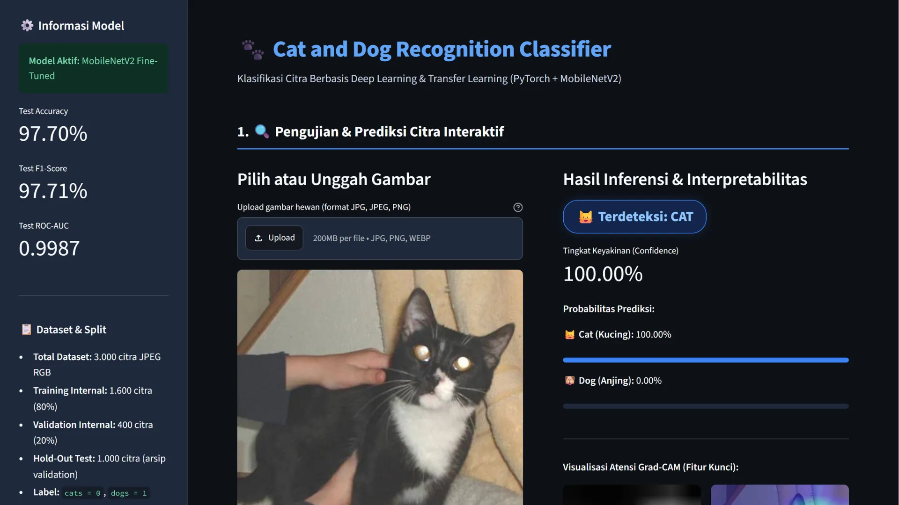
Top view of the Streamlit web interface displaying the model telemetry sidebar (`97.70%` Test Accuracy, `97.71%` F1-Score, `0.9987` ROC-AUC), image upload widget, sample cat preview (`cat.2000.jpg`), and probabilistic classification output predicting `CAT` with `100.00%` confidence.

### 2. Real-Time Grad-CAM Attention Overlay & Sample Selector
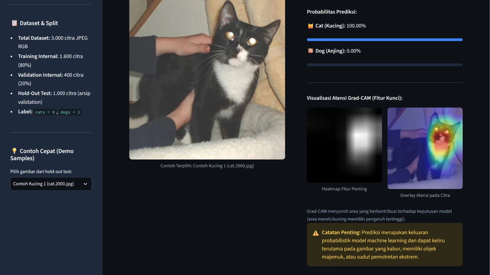
Interactive Grad-CAM explainability panel inside the Streamlit application showing both the raw grayscale importance map and jet heatmap overlay centered on the cat's face and eyes, alongside the hold-out demo sample selector and probabilistic prediction disclaimer.

### 3. Hold-Out Test Metrics, Confusion Matrix & ROC Curve
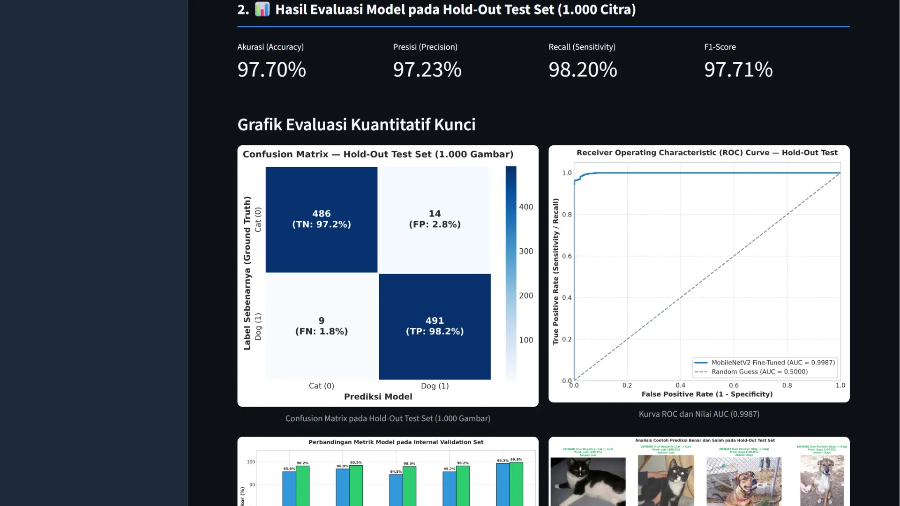
Quantitative evaluation section of the dashboard summarizing hold-out test Accuracy (`97.70%`), Precision (`97.23%`), Recall (`98.20%`), and F1-Score (`97.71%`), paired with the `486 / 14 / 9 / 491` Confusion Matrix and ROC Curve (`AUC = 0.9987`).

### 4. Model Comparison, Prediction Grid & Anti-Leakage Summary
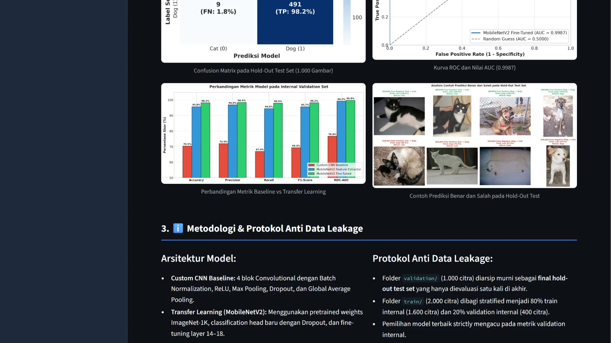
Lower dashboard section comparing internal validation metrics across all three models, showcasing correct and misclassified hold-out prediction examples, and documenting the anti-data-leakage split protocol and MobileNetV2 architecture.

### 5. Dataset Samples, Error Cases & Grad-CAM Montage
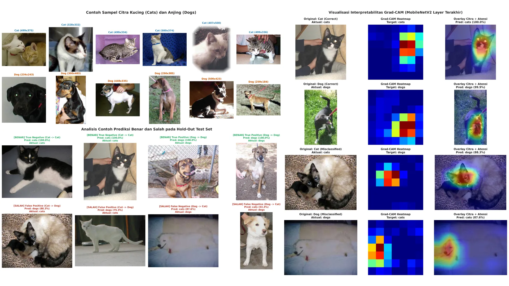
Composite diagnostic collage pairing representative `Cats` and `Dogs` dataset samples with hold-out prediction outcomes (`True Negative`, `True Positive`, `False Positive`, `False Negative`) and 3-column Grad-CAM visual explanations (`Original`, `Heatmap`, `Overlay`) on both correctly classified and misclassified animals.

### 6. Image Width, Height & Aspect Ratio Distribution
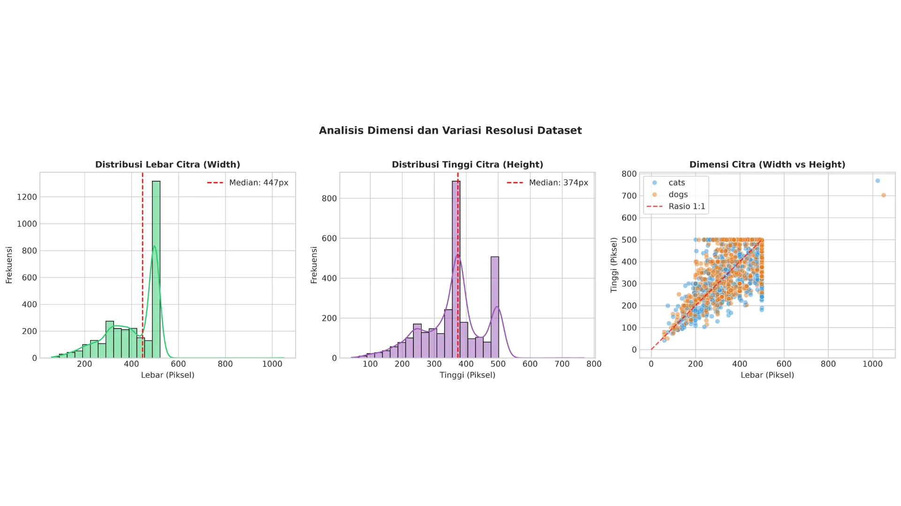
Exploratory dimension analysis across all `3,000` dataset images revealing a median width of `447 px`, median height of `374 px`, and width-vs-height scatter distribution clustering around landscape ratios (`mean = 1.1617`), motivating standardized `224 x 224` preprocessing.

### 7. Training & Validation Loss Convergence Curves
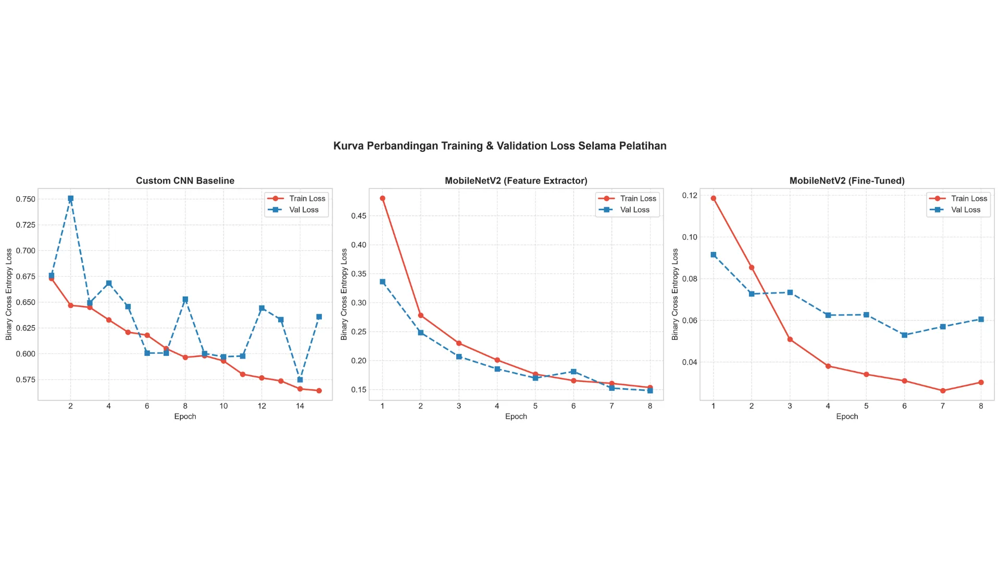
Binary Cross-Entropy loss curves across training epochs comparing `Custom CNN Baseline` (`0.5749` best val loss over 15 epochs with visible fluctuations), `MobileNetV2 Feature Extractor` (`0.1481` val loss over 8 epochs), and `MobileNetV2 Fine-Tuned` (smooth convergence to `0.0530` val loss at epoch 6).

### 8. Training & Validation Accuracy Curves
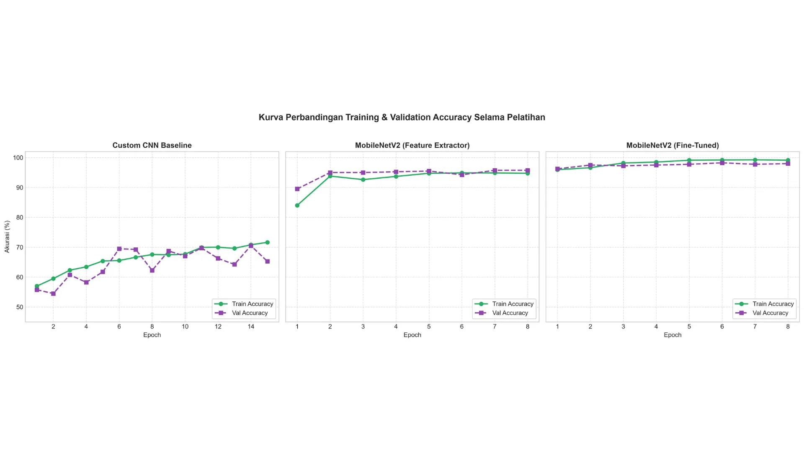
Epoch-wise accuracy trajectories illustrating the performance jump from `Custom CNN Baseline` (`70.50%` peak val accuracy) to `MobileNetV2 Feature Extractor` (`95.75%` val accuracy) and `MobileNetV2 Fine-Tuned` (`98.25%` peak val accuracy at epoch 6 with minimal train-validation gap).

### 9. Hold-Out ROC & Precision-Recall Curves
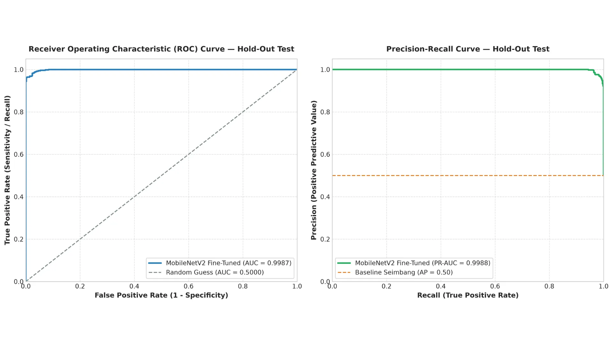
Hold-out test discrimination curves for `MobileNetV2 Fine-Tuned` achieving `ROC-AUC = 0.9987` (far above the `0.5000` random baseline) and `PR-AUC = 0.9988` while sustaining precision above `95%` nearly up to `100%` recall.

### 10. Composite Confusion Matrix, Model Benchmark & Class Distribution
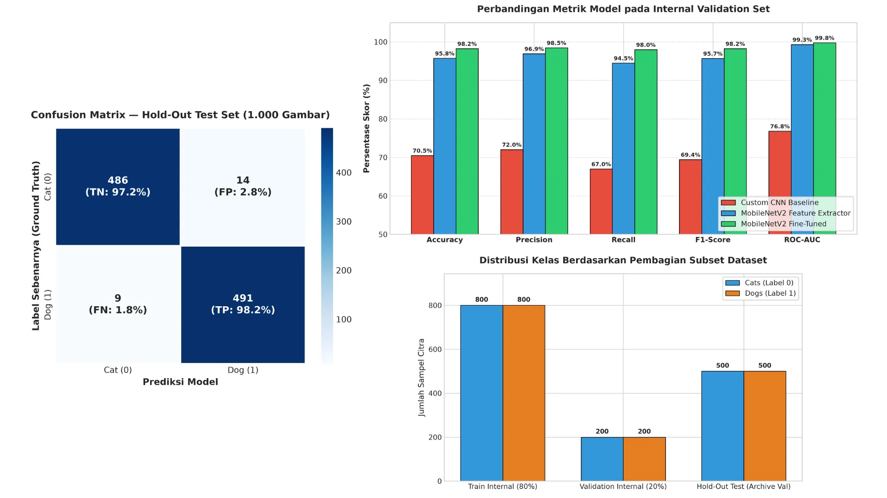
Summary visualization combining the hold-out Confusion Matrix (`97.2%` cat recall, `98.2%` dog recall), internal validation bar chart across all five metrics (`Accuracy`, `Precision`, `Recall`, `F1-Score`, `ROC-AUC`), and exact `50:50` class balance across Train Internal (`800/800`), Val Internal (`200/200`), and Hold-Out Test (`500/500`).

## Prerequisites

- **Operating System**: Windows, Linux, or macOS (developed and verified on Windows 11 64-bit).
- **Python**: Python `3.10+` (`models/model_config.json` and `final_report.md` record execution on Python `3.15.1` with `PyTorch 2.15.0+cpu`).
- **Core Dependencies**: Packages listed in [`requirements.txt`](requirements.txt) (`torch>=2.0.0`, `torchvision>=0.15.0`, `numpy>=1.24.0`, `pandas>=2.0.0`, `pillow>=10.0.0`, `scikit-learn>=1.3.0`, `matplotlib>=3.7.0`, `seaborn>=0.12.0`, `streamlit>=1.30.0`).
- **Compute Hardware**: CPU execution is fully supported for both training and inference (no GPU required; optional CUDA GPU is used automatically when `torch.cuda.is_available()` is true).
- **Pretrained Weights Access**: Internet access on first run of `src/train.py` if downloading Torchvision `MobileNet_V2_Weights.DEFAULT` (not needed for inference with included [`models/best_model.pt`](models/best_model.pt)).

## Installation & Setup

1. Clone the repository and enter the project directory:
   ```bash
   git clone https://github.com/weztcy/Cat-and-Dog-Recognition-Using-Convolutional-Networks.git
   cd "Cat and Dog Recognition Using Convolutional Networks"
   ```
2. Create and activate a Python virtual environment:
   ```bash
   python -m venv .venv
   # Windows PowerShell
   .\.venv\Scripts\Activate.ps1
   # Linux / macOS
   source .venv/bin/activate
   ```
3. Install all required packages from [`requirements.txt`](requirements.txt):
   ```bash
   pip install -r requirements.txt
   ```

## Usage & Execution

Once dependencies are installed, you can run single-image CLI inference using the pre-saved checkpoint [`models/best_model.pt`](models/best_model.pt), launch the Streamlit web interface, or re-run the evaluation and training scripts from the repository root.

1. **Single-Image Inference via CLI** ([`src/predict.py`](src/predict.py)):
   ```bash
   python src/predict.py dataset/original/validation/cats/cat.2000.jpg
   ```
2. **Launch Interactive Streamlit Web Dashboard** ([`streamlit/app.py`](streamlit/app.py)):
   ```bash
   python -m streamlit run streamlit/app.py
   ```
3. **Run Comprehensive Model Evaluation & Visualizations** ([`src/evaluate.py`](src/evaluate.py)):
   ```bash
   python src/evaluate.py
   ```

## Model Deployment & Serving

The project includes a local interactive web serving interface implemented in [`streamlit/app.py`](streamlit/app.py) and configured via [`.streamlit/config.toml`](.streamlit/config.toml) with a dark theme (`#0e1117` background, `#3b82f6` primary accent) bound to `127.0.0.1:8501`.

1. Ensure [`models/best_model.pt`](models/best_model.pt), [`models/model_config.json`](models/model_config.json), and [`metrics.json`](metrics.json) are available in their expected paths (note: `streamlit/app.py` reads `results/metrics.json` for sidebar telemetry if placed under `results/`, while inference loads directly from `models/`).
2. Start the Streamlit server in headless mode using the project configuration:
   ```bash
   python -m streamlit run streamlit/app.py
   ```
3. Open `http://127.0.0.1:8501` in a browser to upload `JPG`/`JPEG`/`PNG`/`WEBP` images, inspect predicted class probabilities (`Cat` vs `Dog`), view real-time Grad-CAM attention overlays, and review evaluation charts.

## Reproducibility & Execution

Experiment reproducibility is anchored by `RANDOM_SEED = 42` across `random`, `numpy`, and `torch` in [`src/data_audit.py`](src/data_audit.py) and [`src/train.py`](src/train.py), together with the persisted [`dataset_split.json`](dataset_split.json) manifest and [`models/model_config.json`](models/model_config.json).

1. **Verify File Paths Before Full Re-Training**: In the archived repository layout, raw image folders reside under `dataset/original/train/` and `dataset/original/validation/`, and JSON/CSV outputs sit in the repository root and `figures/`, whereas `src/data_audit.py`, `src/dataset.py`, `src/train.py`, and `src/evaluate.py` reference `dataset/train`, `dataset/validation`, `results/`, and `visualizations/`. Align directory paths or symlinks before executing the full end-to-end training pipeline from scratch.
2. **Audit & Split Dataset**:
   ```bash
   python src/data_audit.py
   ```
3. **Train All Three Architectures & Save Best Checkpoint**:
   ```bash
   python src/train.py
   ```
4. **Re-Run Hold-Out Evaluation & Generate All Plots**:
   ```bash
   python src/evaluate.py
   ```
5. **Nondeterminism Note**: While random seeds are fixed (`seed = 42`), minor floating-point variations may still occur across different PyTorch versions, CPU/CUDA backends, or Torchvision image decoders.

## Contributing

Contributions to improve model generalization, add multi-object detection support, or refine the inference interface are welcome. Please follow this standard workflow:

1. Fork the repository.
2. Create a branch for the change.
3. Make the changes.
4. Run relevant checks or tests when available.
5. Commit and push the branch.
6. Open a pull request with a clear explanation.

## License

This project is licensed under the MIT License.
See the [LICENSE](LICENSE) file for details.

## Author & Contact

**Yohanes Dimas Pratama**

- GitHub: [github.com/weztcy](https://github.com/weztcy)
- Portfolio: [yohanesdimas.com](https://yohanesdimas.com)
- LinkedIn: [linkedin.com/in/yohanes-dimas](https://www.linkedin.com/in/yohanes-dimas)
