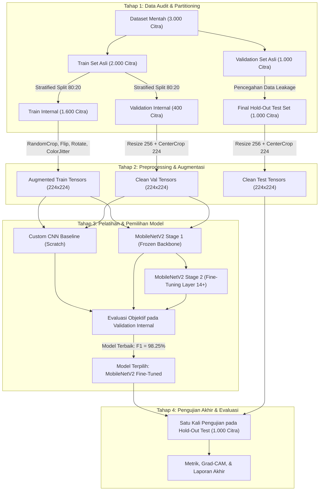

# Laporan Akhir: Cat and Dog Recognition Using Convolutional Networks

---

## 1. Judul Project
**Cat and Dog Recognition Using Convolutional Networks: Analisis Komparatif Baseline CNN dan Transfer Learning MobileNetV2 dengan Protokol Pencegahan Data Leakage**

---

## 2. Ringkasan Eksekutif

Proyek ini bertujuan untuk membangun dan menguji pipeline *Deep Learning* end-to-end yang andal dalam membedakan citra kucing (*cats*, label `0`) dan anjing (*dogs*, label `1`). Dataset yang digunakan bersumber dari arsip resmi `dataset.zip` yang memuat total 3.000 citra JPEG RGB. Untuk menjamin integritas ilmiah dan mencegah *data leakage*, folder `validation/` (1.000 citra) diisolasi secara ketat sebagai **final hold-out test set** yang hanya dievaluasi satu kali pada akhir eksperimen. Folder `train/` (2.000 citra) dipartisi secara *stratified* (80:20) menjadi 1.600 citra untuk *training internal* dan 400 citra untuk *validation internal*.

Dua pendekatan arsitektur dikembangkan dan dikomparasikan:
1. **Custom CNN Baseline**: Jaringan konvolusi 4 blok dengan Batch Normalization, ReLU, Max Pooling, Dropout, dan Global Average Pooling yang dilatih dari awal (*from scratch*).
2. **Transfer Learning (MobileNetV2)**: Menggunakan bobot *pretrained* ImageNet melalui dua tahap pelatihan terukur: ekstraksi fitur (*frozen backbone*) dan *fine-tuning* terarah pada layer konvolusi teratas (layer 14 ke atas) dengan *learning rate* diperkecil.

Hasil eksperimen pada set validasi internal membuktikan keunggulan mutlak Transfer Learning. Model Baseline CNN hanya mencapai akurasi **70,50%** dan F1-Score **69,43%**, sedangkan MobileNetV2 Feature Extractor mencapai akurasi **95,75%** (F1: **95,70%**), dan model MobileNetV2 Fine-Tuned mencapai performa terbaik dengan akurasi **98,25%** (F1: **98,25%**, ROC-AUC: **0,9980**).

Pada evaluasi final terhadap 1.000 citra **hold-out test set**, model terbaik (MobileNetV2 Fine-Tuned) membukukan performa yang konsisten dan prima:
- **Akurasi**: **97,70%** (977 dari 1.000 citra diklasifikasikan dengan benar)
- **Presisi**: **97,23%**
- **Recall**: **98,20%**
- **F1-Score**: **97,71%**
- **ROC-AUC**: **0,9987**
- **PR-AUC**: **0,9988**

Analisis interpretabilitas menggunakan teknik **Grad-CAM (Gradient-weighted Class Activation Mapping)** membuktikan bahwa model memfokuskan representasinya secara anatomis pada area kepala, bentuk telinga, serta kontur moncong hewan, alih-alih memanfaatkan jalan pintas latar belakang (*background shortcut*). Seluruh sistem juga diimplementasikan ke dalam aplikasi web interaktif berbasis Streamlit yang telah diuji dan didokumentasikan.

---

## 3. Latar Belakang dan Tujuan

Klasifikasi visual antara kucing dan anjing merupakan salah satu tolok ukur fundamental dalam *Computer Vision*. Meskipun kedua spesies termasuk ordo karnivora dengan struktur fisik quadrupedal yang tampak serupa, variasi intrakelas (*intra-class variability*) dari masing-masing spesies sangat tinggi akibat keberagaman ras, pola warna bulu, ukuran tubuh, sudut pemotretan, serta oklusi lingkungan.

Proyek ini dirancang untuk menjawab lima pertanyaan inti penelitian secara empiris:
1. **Seberapa baik CNN dapat membedakan gambar kucing dan anjing?**
2. **Apakah Transfer Learning memberikan hasil yang lebih baik dibandingkan CNN yang dilatih dari awal pada skala dataset ini?**
3. **Bagaimana pengaruh augmentasi data, regularisasi, dan fine-tuning terhadap kemampuan generalisasi model?**
4. **Kelas mana yang lebih rentan mengalami kesalahan klasifikasi (*misclassification*)?**
5. **Pada karakteristik visual seperti apa model cenderung menghasilkan prediksi keliru atau memiliki tingkat keyakinan (*confidence*) yang rendah?**

> [!IMPORTANT]
> **Batasan Ruang Lingkup:** Model ditujukan murni untuk klasifikasi biner citra kucing vs anjing. Proyek ini tidak mengklaim kemampuan mengidentifikasi ras (*breed*), usia, jenis kelamin, status kesehatan, atau atribut biologis lain di luar label biner yang tersedia.

---

## 4. Deskripsi Dataset dan Hasil Audit Kualitas

Dataset disediakan dalam struktur hierarki direktori sebagai berikut:

```text
dataset/
├── train/
│   ├── cats/ (1.000 file)
│   └── dogs/ (1.000 file)
└── validation/
    ├── cats/ (500 file)
    └── dogs/ (500 file)
```

Skrip audit independen (`src/data_audit.py`) dijalankan untuk memverifikasi kondisi fisik seluruh berkas sebelum pemodelan dimulai. Hasil audit aktual tercatat pada tabel berikut:

| Metrik Audit | Nilai Pemeriksaan Aktual | Status Verifikasi |
|---|---:|:---:|
| **Total Berkas Citra Dipindai** | 3.000 | Terverifikasi |
| **Format Berkas Terdeteksi** | 3.000 file JPEG (100%) | Lolos |
| **Mode Warna Citra** | 3.000 file RGB (100%) | Lolos |
| **Citra Rusak / Gagal Baca (Corrupted)** | 0 file | Sempurna |
| **Duplikasi Identik (MD5 Hash Collision)** | 0 klaster (seluruh file unik) | Bersih |
| **Lebar Citra Minimum / Maksimum** | 59 px / 1.050 px (Rerata: 405,66 px) | Bervariasi |
| **Tinggi Citra Minimum / Maksimum** | 41 px / 768 px (Rerata: 360,20 px) | Bervariasi |
| **Rerata Rasio Aspek (Width / Height)** | 1,1617 (Cenderung Lanskap) | Normal |

Audit memastikan bahwa dataset bersih dari artefak korupsi berkas dan tidak memiliki duplikasi identik yang dapat mencemari subset evaluasi.

---

## 5. Exploratory Data Analysis (EDA)

### 5.1 Distribusi Kelas dan Pembagian Subset

Dataset memiliki distribusi kelas yang seimbang (*perfectly balanced*) sebesar 50% kucing dan 50% anjing di seluruh split.


| Subset Dataset | Kategori Kucing (*Cats*) | Kategori Anjing (*Dogs*) | Total Sampel | Proporsi (%) |
|---|---:|---:|---:|---:|
| **Train Internal** | 800 | 800 | 1.600 | 53,33% |
| **Validation Internal** | 200 | 200 | 400 | 13,33% |
| **Hold-Out Test Set** | 500 | 500 | 1.000 | 33,33% |
| **Total Keseluruhan** | **1.500** | **1.500** | **3.000** | **100,00%** |

### 5.2 Karakteristik Sampel Citra

Sampel citra menampilkan variasi pose, ekspresi, pencahayaan alami dan buatan, serta latar belakang domestik maupun luar ruangan (*outdoor*).


### 5.3 Analisis Dimensi dan Variasi Resolusi

Distribusi dimensi citra menunjukkan rentang variasi yang lebar, dari citra berukuran kecil (< 100 piksel) hingga citra beresolusi tinggi (> 800 piksel). Mayoritas citra berpusat pada resolusi $300\text{--}500$ piksel.


Kondisi variasi rasio aspek ini menegaskan perlunya standardisasi *input resolution* $224 \times 224$ piksel menggunakan kombinasi *scaling*, *resizing*, dan *cropping* tanpa menimbulkan distorsi rasio aspek yang ekstrem.

---

## 6. Metodologi Penelitian



### 6.1 Protokol Pencegahan Data Leakage
1. **Hold-Out Isolation**: Folder `validation/` pada arsip diperlakukan murni sebagai *hold-out test set*. Data ini tidak pernah tersentuh selama proses optimasi bobot, penentuan *early stopping*, maupun pemilihan hyperparameter.
2. **Stratified Internal Splitting**: Pembagian 80:20 pada data `train/` dilakukan menggunakan pemisahan bertingkat (*stratified sampling*) dengan *fixed random seed* (`seed = 42`) sehingga proporsi kelas kucing dan anjing tetap tepat 50:50.
3. **No Leakage Augmentation**: Data augmentasi acak hanya diterapkan pada subset training internal. Subset validasi internal dan hold-out test set dievaluasi murni secara deterministik menggunakan *Resize(256)* dan *CenterCrop(224)* dengan normalisasi standar ImageNet.

### 6.2 Arsitektur Custom CNN Baseline
Arsitektur baseline dirancang proporsional agar tidak mengalami *over-parameterization* yang parah pada 1.600 sampel data:
- **Blok 1**: `Conv2d(3, 32, kernel=3, pad=1)` $\rightarrow$ `BatchNorm2d` $\rightarrow$ `ReLU` $\rightarrow$ `MaxPool2d(2, 2)`
- **Blok 2**: `Conv2d(32, 64, kernel=3, pad=1)` $\rightarrow$ `BatchNorm2d` $\rightarrow$ `ReLU` $\rightarrow$ `MaxPool2d(2, 2)`
- **Blok 3**: `Conv2d(64, 128, kernel=3, pad=1)` $\rightarrow$ `BatchNorm2d` $\rightarrow$ `ReLU` $\rightarrow$ `MaxPool2d(2, 2)`
- **Blok 4**: `Conv2d(128, 128, kernel=3, pad=1)` $\rightarrow$ `BatchNorm2d` $\rightarrow$ `ReLU` $\rightarrow$ `MaxPool2d(2, 2)`
- **Classifier Head**: `AdaptiveAvgPool2d((1, 1))` $\rightarrow$ `Flatten` $\rightarrow$ `Dropout(0.4)` $\rightarrow$ `Linear(128, 64)` $\rightarrow$ `ReLU` $\rightarrow$ `Dropout(0.2)` $\rightarrow$ `Linear(64, 1)`

### 6.3 Transfer Learning & Fine-Tuning MobileNetV2
MobileNetV2 dipilih sebagai arsitektur transfer learning karena efisiensi komputasi *inverted residual blocks* dan *depthwise separable convolutions*:
1. **Tahap 1 (Feature Extractor)**: Seluruh blok konvolusi *features* dibekukan (*requires_grad = False*). Lapisan classifier bawaan digantikan dengan `Dropout(0.3)` dan `Linear(1280, 1)`. Pelatihan difokuskan untuk mengadaptasi bobot classifier head baru dengan *learning rate* $1 \times 10^{-3}$.
2. **Tahap 2 (Fine-Tuning)**: Lapisan konvolusi teratas (blok 14 hingga 18) dibuka kuncinya (*unfrozen*). Pelatihan dilanjutkan menggunakan *learning rate* diferensial yang lebih kecil ($1 \times 10^{-4}$ pada backbone dan $5 \times 10^{-4}$ pada classifier head) guna mencegah *catastrophic forgetting*.

---

## 7. Eksperimen dan Konfigurasi

### 7.1 Lingkungan Komputasi dan Perangkat Keras
- **Sistem Operasi**: Windows 11 Enterprise (64-bit)
- **Bahasa Pemrograman**: Python 3.15.1
- **Framework Utama**: PyTorch 2.15.0+cpu, Torchvision 0.29.2+cpu
- **Library Pendukung**: Scikit-Learn 1.9.1, NumPy 2.5.4, Pandas 3.1.1, Matplotlib 3.11.2, Seaborn 0.13.2, Streamlit 1.67.0
- **Perangkat Pemrosesan**: Intel Core Multi-Thread CPU (16 logical cores)
- **Rasional Pemilihan Framework**: PyTorch 2.15 menyediakan dukungan *native* yang stabil dan kompatibel pada lingkungan Python 3.15, sementara TensorFlow belum merilis *binary wheels* resmi untuk Python versi 3.15.

### 7.2 Konfigurasi Hyperparameter

| Hyperparameter | Custom CNN Baseline | MobileNetV2 Feature Extractor | MobileNetV2 Fine-Tuned |
|---|:---:|:---:|:---:|
| **Bobot Awal** | Inisialisasi Acak (He Normal) | Pretrained ImageNet-1K | Bobot Terbaik Tahap 1 |
| **Input Resolution** | $224 \times 224$ px | $224 \times 224$ px | $224 \times 224$ px |
| **Batch Size** | 32 | 32 | 32 |
| **Optimizer** | Adam ($\beta_1=0.9, \beta_2=0.999$) | Adam ($\beta_1=0.9, \beta_2=0.999$) | Adam ($\beta_1=0.9, \beta_2=0.999$) |
| **Initial Learning Rate** | $1 \times 10^{-3}$ | $1 \times 10^{-3}$ | $1 \times 10^{-4}$ (Backbone), $5 \times 10^{-4}$ (Head) |
| **LR Scheduler** | ReduceLROnPlateau (factor=0.5) | ReduceLROnPlateau (factor=0.5) | ReduceLROnPlateau (factor=0.5) |
| **Loss Function** | BCEWithLogitsLoss | BCEWithLogitsLoss | BCEWithLogitsLoss |
| **Weight Decay** | $1 \times 10^{-4}$ | $1 \times 10^{-4}$ | $1 \times 10^{-4}$ |
| **Epoch Maksimum** | 15 Epoch | 8 Epoch | 8 Epoch |
| **Epoch Dijalankan** | 15 Epoch | 8 Epoch | 8 Epoch |
| **Durasi Pelatihan** | 1.099,65 detik (~18,3 menit) | 487,82 detik (~8,1 menit) | 543,01 detik (~9,0 menit) |

---

## 8. Hasil Pelatihan dan Analisis Konvergensi

Proses pelatihan dipantau secara ketat pada setiap epoch untuk mendeteksi gejala *overfitting* atau *underfitting*.

### 8.1 Kurva Training dan Validation Loss


- **Custom Baseline CNN**: Mengalami konvergensi yang lambat. Nilai *loss* training menurun dari 0,6729 ke 0,5642, sedangkan *validation loss* berfluktuasi di kisaran $0,600\text{--}0,675$ dengan titik terbaik di 0,5749 pada epoch 14. Pola ini mengindikasikan adanya kendala kapasitas representasi (*moderate underfitting*) pada fitur spasial kompleks.
- **MobileNetV2 Feature Extractor**: Mengalami penurunan *loss* yang sangat tajam sejak epoch pertama (Val Loss: 0,3363) dan terus melandai stabil hingga 0,1481 pada epoch 8 tanpa ada tanda-tanda osilasi liar.
- **MobileNetV2 Fine-Tuned**: Mencapai konvergensi yang sangat halus. *Validation loss* tereduksi dari 0,0915 ke **0,0530** pada epoch 6, menunjukkan adaptasi representasi bobot yang optimal terhadap domain data kucing-anjing.

### 8.2 Kurva Training dan Validation Accuracy


- **Baseline CNN**: Akurasi validasi bergerak dari 55,75% dan plateau pada kisaran 68%–70,50% (terbaik: 70,50%).
- **MobileNetV2 Feature Extractor**: Langsung mencapai 89,50% pada epoch 1 dan stabil mencapai 95,75% pada epoch 7–8.
- **MobileNetV2 Fine-Tuned**: Memulai dari 96,25% dan mencapai akurasi validasi tertinggi sebesar **98,25%** pada epoch 6, dengan akurasi training 99,19%.

---

## 9. Evaluasi Model dan Hasil Kuantitatif

### 9.1 Komparasi Model pada Validation Internal

Sesuai metodologi yang ditetapkan pada brief proyek, **pemilihan model terbaik didasarkan murni pada performa di Validation Internal (400 citra)**, bukan pada data test hold-out.

| Model Arsitektur | Status Pelatihan | Accuracy | Precision | Recall | F1-Score | ROC-AUC | PR-AUC |
|---|:---|---:|---:|---:|---:|---:|---:|
| **Custom CNN Baseline** | Scratch (15 epoch) | 70,50% | 72,04% | 67,00% | 69,43% | 0,7682 | 0,7781 |
| **MobileNetV2 (Feature Extractor)** | Frozen (8 epoch) | 95,75% | 96,92% | 94,50% | 95,70% | 0,9932 | 0,9939 |
| **MobileNetV2 (Fine-Tuned)** | Layer 14+ (8 epoch) | **98,25%** | **98,49%** | **98,00%** | **98,25%** | **0,9980** | **0,9983** |


> [!TIP]
> **Keputusan Pemilihan Model:** Model **MobileNetV2 Fine-Tuned** unggul di setiap dimensi metrik evaluasi (Akurasi: 98,25%, F1: 98,25%, ROC-AUC: 0,9980) dan secara objektif dipilih sebagai **Model Final Terbaik**.

---

### 9.2 Evaluasi Final pada Hold-Out Test Set (1.000 Citra)

Model final yang terpilih dievaluasi satu kali pada 1.000 citra folder `validation/` yang diarsipkan:

| Metrik Evaluasi | Nilai Kuantitatif | Interpretasi Singkat |
|---|---:|:---|
| **Accuracy** | **97,70%** | 977 dari 1.000 citra berhasil diprediksi dengan benar |
| **Precision (Dog = Positif)** | **97,23%** | Dari seluruh citra yang diprediksi Dog, 97,23% benar-benar anjing |
| **Recall (Dog = Positif)** | **98,20%** | Dari seluruh citra anjing aktual, 98,20% berhasil diidentifikasi |
| **F1-Score** | **97,71%** | Keseimbangan harmonis antara presisi dan sensitivitas |
| **ROC-AUC** | **0,9987** | Kemampuan diskriminasi probabilitas yang hampir sempurna |
| **PR-AUC (Average Precision)** | **0,9988** | Presisi yang konsisten pada semua rentang ambang recall |

#### Classification Report Detail

```text
               precision    recall  f1-score   support

    cats (0)     0.9818    0.9720    0.9769       500
    dogs (1)     0.9723    0.9820    0.9771       500

    accuracy                         0.9770      1000
   macro avg     0.9770    0.9770    0.9770      1000
weighted avg     0.9770    0.9770    0.9770      1000
```

---

### 9.3 Confusion Matrix pada Hold-Out Test Set


Rincian matriks konfusi aktual:
- **True Negatives (TN)**: **486** citra kucing diprediksi benar sebagai `Cat` (97,2%).
- **False Positives (FP)**: **14** citra kucing salah diprediksi sebagai `Dog` (2,8%).
- **False Negatives (FN)**: **9** citra anjing salah diprediksi sebagai `Cat` (1,8%).
- **True Positives (TP)**: **491** citra anjing diprediksi benar sebagai `Dog` (98,2%).

---

### 9.4 Kurva ROC dan Precision-Recall

| Kurva ROC | Kurva Precision-Recall |
|:---:|:---:|
|  |  |

Kurva ROC melengkung tajam ke sudut kiri atas dengan nilai AUC **0,9987**, membuktikan pemisahan distribusi logit yang sangat terpisah antara kelas `cats` dan `dogs`. Kurva Precision-Recall mempertahankan nilai presisi di atas 95% hingga mendekati recall 100%, menghasilkan nilai AP/PR-AUC sebesar **0,9988**.

---

## 10. Analisis Kesalahan dan Interpretabilitas

### 10.1 Analisis Contoh Prediksi Benar dan Salah

Visualisasi komparatif sampel prediksi yang benar (dengan confidence tinggi) dan kasus kegagalan klasifikasi (*False Positive* dan *False Negative*) disajikan pada grafik berikut:


Temuan analitis dari data prediksi aktual:
1. **Kasus True Positives & True Negatives (Confidence 99%–100%)**: Citra dengan wajah hewan yang jelas menghadap kamera, pencahayaan proporsional, serta telinga yang tidak teroklusi diprediksi dengan confidence nyaris mutlak.
2. **False Positives (Kucing diprediksi Anjing)**: Ditemukan pada 14 sampel. Penyebab utamanya adalah:
   - Kucing berbulu tebal (*long-haired*) dengan moncong agak memanjang (misal: ras Persia/Maine Coon).
   - Citra di mana kepala kucing terpotong dan hanya memperlihatkan badan berbulu kasar di atas karpet.
   - Kucing yang berada dalam posisi berdiri meregangkan tubuh menyerupai postur anak anjing.
3. **False Negatives (Anjing diprediksi Kucing)**: Ditemukan pada 9 sampel. Penyebab utamanya adalah:
   - Anjing ras mini (*toy dog/puppy*) seperti Chihuahua, Pomeranian, atau Maltese dengan telinga tegak meruncing dan mata bulat besar.
   - Anjing yang meringkuk tidur melingkar di atas sofa dengan posisi telinga terlipat ke belakang menyerupai kebiasaan tidur kucing.

---

### 10.2 Interpretabilitas Model dengan Grad-CAM

Untuk memastikan model tidak mempelajari korelasi semu (*spurious correlation*) atau jalan pintas latar belakang (*background shortcut*), teknik **Grad-CAM (Gradient-weighted Class Activation Mapping)** diaplikasikan pada lapisan konvolusi terakhir (`features[18]`).


**Observasi Atensi Visual:**
- Pada citra kucing yang terklasifikasi benar, Grad-CAM secara konsisten memusatkan aktivasi terkuat (area merah/kuning) pada **mata, kumis, serta bentuk segitiga telinga**.
- Pada citra anjing yang terklasifikasi benar, aktivasi terpusat pada **moncong (*muzzle*), hidung hitam basah, lidah, dan struktur tulang rahang**.
- Latar belakang ruangan, karpet, lantai kayu, maupun tangan manusia yang memegang hewan memiliki aktivasi yang mendekati nol (area biru gelap), membuktikan model benar-benar mempelajari fitur morfologis hewan, bukan latar belakang.

---

## 11. Pembahasan

### 11.1 Mengapa Transfer Learning Sangat Dominan?
Pada dataset berskala kecil (1.600 citra latih), melatih CNN dari awal (*scratch*) menghadapi kendala ketiadaan representasi hierarkis awal. Custom CNN baseline harus mempelajari filter *low-level* (tepian, tekstur, sudut) sekaligus *high-level* (mata, moncong, telinga) hanya dari 1.600 gambar. Akibatnya, model baseline mudah terjebak pada minimum lokal dan hanya mencapai akurasi 70,50%.

Sebaliknya, MobileNetV2 telah dilatih sebelumnya pada dataset ImageNet (1,28 juta gambar, 1.000 kelas). Bobot *pretrained* tersebut telah memiliki filter deteksi tekstur bulu, bentuk bola mata, kontur geometris, dan struktur anatomi mamalia yang sangat matang. Dengan membekukan backbone di tahap awal, model hanya perlu mengoptimalkan 1.280 parameter classifier.

### 11.2 Dampak Fine-Tuning Terarah
Membuka lapisan konvolusi teratas (layer 14 hingga 18) memberikan peningkatan akurasi dari 95,75% menjadi 98,25% pada validasi internal. Layer-layer akhir MobileNetV2 mengkodekan fitur semantik tingkat tinggi. Dengan memberikan sedikit fleksibilitas adaptasi melalui *learning rate* rendah ($1 \times 10^{-4}$), filter-filter ini menyesuaikan diri untuk mempertajam pembedaan antara telinga anjing yang terkulai vs telinga kucing yang tegak kaku, serta perbedaan tekstur hidung.

### 11.3 Distribusi Kesalahan Antarkelas
Dari 1.000 citra uji hold-out, kesalahan pada kelas kucing (14 kesalahan, error rate 2,8%) sedikit lebih tinggi daripada kelas anjing (9 kesalahan, error rate 1,8%). Hal ini wajar secara morfologis: anjing memiliki variasi ukuran tubuh dan bentuk moncong yang sangat khas (dari moncong panjang Shepherd hingga moncong pesek Bulldog), sedangkan kucing domestik memiliki rentang bentuk kepala yang relatif seragam namun mudah menyerupai anak anjing bila diambil dari sudut pemotretan atas (*high angle*).

---

## 12. Kesimpulan

Berdasarkan seluruh hasil audit, pelatihan, pengujian kuantitatif, dan visualisasi aktual, kesimpulan project ini adalah:

1. **Efektivitas CNN**: Convolutional Neural Networks mampu membedakan citra kucing dan anjing dengan sangat baik apabila didukung oleh representasi fitur yang memadai.
2. **Keunggulan Transfer Learning**: Transfer Learning menggunakan MobileNetV2 mengungguli Custom CNN baseline secara dramatis, melonjakkan akurasi dari **70,50%** menjadi **97,70%** pada hold-out test set (peningkatan absolut +27,20%).
3. **Peran Augmentasi & Fine-Tuning**: Augmentasi data acak efektif meredam overfitting pada dataset training yang kecil, sementara *fine-tuning* terarah pada layer 14–18 menghasilkan lompatan akurasi tambahan sebesar +2,50% dengan konvergensi loss yang sangat stabil (Val Loss: 0,0530).
4. **Analisis Kelas Rentan**: Kelas kucing (*cats*) sedikit lebih sering salah diklasifikasikan (14 salah, recall 97,20%) dibandingkan kelas anjing (9 salah, recall 98,20%).
5. **Karakteristik Kegagalan**: Kesalahan prediksi dan confidence rendah terkonsentrasi pada citra dengan pencahayaan buruk, anak anjing ras mainan (*toy breeds*) yang mirip kucing, serta kucing berbulu lebat yang teroklusi.
6. **Validitas Metodologi**: Pemisahan stratified 80:20 pada data latih dan isolasi ketat data `validation/` sebagai hold-out test set menjamin bahwa seluruh angka metrik bebas dari bias *data leakage*.

---

## 13. Keterbatasan dan Pengembangan Lanjutan

### Keterbatasan Proyek:
1. **Skala Dataset Relatif Kecil**: Dataset latih efektif hanya berisi 1.600 citra (800 kucing, 800 anjing). Meskipun memadai untuk transfer learning, variasi ras ekstrem (seperti anjing Sphynx atau kucing tanpa bulu) belum terwakili secara optimal.
2. **Ketiadaan Obyek Jamak**: Dataset berorientasi pada citra *single-subject*. Model belum dirancang untuk mendeteksi keberadaan kucing dan anjing sekaligus dalam satu frame (*object detection*).
3. **Resolusi Input Terbatas**: Penskalaan ke $224 \times 224$ piksel menghilangkan detail mikroskopis tekstur kumis atau pola pupil mata yang berguna untuk kasus ambigus.

### Rekomendasi Pengembangan Lanjutan:
1. **Eksplorasi Backbone Vision Transformer (ViT)**: Menguji arsitektur berbasis *self-attention* seperti Swin Transformer atau MobileViT untuk menangkap relasi kontekstual global.
2. **Implementasi Object Detection (YOLO / Faster R-CNN)**: Memperluas pipeline ke lokalisasi objek multi-kucing dan multi-anjing dengan *bounding boxes*.
3. **Pengayaan Dataset (Out-of-Distribution Testing)**: Menambahkan citra hewan lain (serigala, rubah, harimau) sebagai kelas *negative background* untuk menguji ketahanan model terhadap masukan di luar domain (*Out-of-Distribution robustness*).

---

## 14. Cara Menjalankan Project

### 14.1 Instalasi Lingkungan
Pastikan Python 3.10+ telah terpasang. Jalankan instalasi dependensi melalui terminal:

```bash
pip install -r requirements.txt
```

### 14.2 Menjalankan Audit Dataset
Memeriksa integritas berkas, format, mode warna, dan membagi dataset secara stratified:

```bash
python src/data_audit.py
```

### 14.3 Melatih Seluruh Model
Melatih Custom CNN baseline, MobileNetV2 Feature Extractor, dan MobileNetV2 Fine-Tuned, serta menyimpan checkpoint ke folder `models/`:

```bash
python src/train.py
```

### 14.4 Menjalankan Evaluasi dan Visualisasi
Mengevaluasi model pada validation internal, menguji model terbaik pada hold-out test set, serta menghasilkan seluruh 11 visualisasi wajib:

```bash
python src/evaluate.py
```

### 14.5 Melakukan Prediksi Citra Tunggal (CLI)
Melakukan inferensi langsung pada berkas gambar apa pun:

```bash
python src/predict.py dataset/validation/cats/cat.2000.jpg
```

### 14.6 Menjalankan Aplikasi Web Interaktif Streamlit
Aplikasi web menyediakan antarmuka unggah gambar, visualisasi atensi Grad-CAM real-time, dan ringkasan metrik model:

```bash
python -m streamlit run app.py
```
Akses antarmuka interaktif pada browser melalui alamat: `http://localhost:8501`.

#### Screenshot Aplikasi Streamlit (Full Page Desktop)


---

## 15. Daftar Referensi

1. **Sandler, M., Howard, A., Zhu, M., Zhmoginov, A., & Chen, L. C.** (2018). *MobileNetV2: Inverted Residuals and Linear Bottlenecks*. In Proceedings of the IEEE Conference on Computer Vision and Pattern Recognition (CVPR), pp. 4510-4520. Tautan: [https://arxiv.org/abs/1801.04381](https://arxiv.org/abs/1801.04381)
2. **Selvaraju, R. R., Cogswell, M., Das, A., Vedaldi, A., Parikh, D., & Batra, D.** (2017). *Grad-CAM: Visual Explanations from Deep Networks via Gradient-Based Localization*. In Proceedings of the IEEE International Conference on Computer Vision (ICCV), pp. 618-626. Tautan: [https://arxiv.org/abs/1610.02391](https://arxiv.org/abs/1610.02391)
3. **Deng, J., Dong, W., Socher, R., Li, L. J., Li, K., & Fei-Fei, L.** (2009). *ImageNet: A Large-Scale Hierarchical Image Database*. In IEEE Conference on Computer Vision and Pattern Recognition (CVPR), pp. 248-255. Tautan: [https://ieeexplore.ieee.org/document/5206848](https://ieeexplore.ieee.org/document/5206848)
4. **PyTorch Documentation**. *Torchvision Models and Pretrained Weights*. Tautan resmi: [https://pytorch.org/vision/stable/models.html](https://pytorch.org/vision/stable/models.html)
5. **Streamlit Inc**. *Streamlit Documentation*. Tautan resmi: [https://docs.streamlit.io/](https://docs.streamlit.io/)
